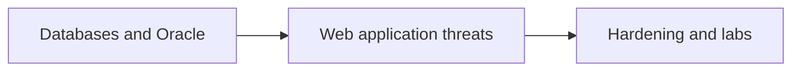

# IA 385 — Database and Web Application Security

College coursework archive for **IA 385 — Database and Web Application Security** at Eastern Michigan University.  
Labs and assignments on database hardening, Oracle install notes, and web application security topics.

**Author:** [Julio Barros](https://github.com/Jkbarros)  
**Index:** [college-projects](https://github.com/Jkbarros/college-projects)

## What is in this repository

| Area | Description |
|------|-------------|
| [`archive/canvas-submissions/`](archive/canvas-submissions/) | Labs 1-2, assignments 3-6, Oracle install write-ups |

### Highlights

- Lab 1 and Lab 2 (final submissions)
- Assignments 3-6 including Oracle installation documentation

## Topics covered

## Related repos

| Course | Link |
|--------|------|
| IA 103 — Information Security Overview | [information-security-overview](https://github.com/Jkbarros/information-security-overview) |
| college-projects index | [college-projects](https://github.com/Jkbarros/college-projects) |

## Roadmap

- [ ] Convert key submissions to markdown in `docs/` (same pattern as IA 103)
- [ ] Redact any sensitive identifiers before expanding public docs

## Notes for readers

- This repo documents **my submitted work** for academic context only.
- EMU or publisher course materials are not redistributed beyond my own submissions in `archive/`.

## License

Content © Julio Barros. Use at your own risk.
