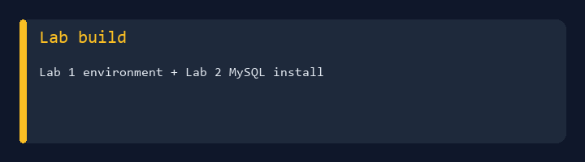
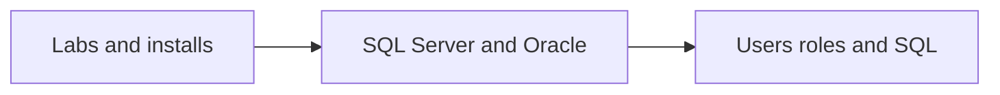

# IA 385 - Database and Web Application Security



College coursework portfolio for **IA 385** at Eastern Michigan University.  
Hands-on work across **MySQL**, **SQL Server**, and **Oracle**, plus **users/roles**, **password policy**, and **SQL** assignments.

**Author:** [Julio Barros](https://github.com/Jkbarros)  
**Index:** [college-projects](https://github.com/Jkbarros/college-projects)

## What is in this repository

| Area | Description |
|------|-------------|
| [Submissions catalog](docs/submissions-catalog.md) | Labs 1–2 and assignments 3–6 |
| [Lab 1 — Lab build](docs/lab-1-lab-build.md) | Environment setup |
| [Lab 2 — MySQL install](docs/lab-2-mysql-install.md) | MySQL installation lab |
| [Assignment 3 — SQL Server](docs/assignment-3-sql-server.md) | SQL Server Community Edition |
| [Assignment 4 — Oracle](docs/assignment-4-oracle-install.md) | Oracle install walkthrough |
| [Assignment 5 — Users & roles](docs/assignment-5-users-roles.md) | MySQL users, roles, password validation |
| [Assignment 6 — SQL queries](docs/assignment-6-sql-queries.md) | Query exercises |
| [Archive index](docs/archive-index.md) | Original DOCX links |
| [`archive/canvas-submissions/`](archive/canvas-submissions/) | Canvas exports |

### Highlights

- Six DOCX submissions converted to markdown (SQL snippets fenced where detected)
- Multi-DB thread: **MySQL → SQL Server → Oracle → hardening & queries**

## Topics covered



## Regenerate docs

```bash
pip install -r requirements.txt
python scripts/docx_to_markdown.py
python scripts/generate_readme_demo.py
```

## Related repos

| Course | Link |
|--------|------|
| IA 329 - Policy Development | [ia329-policy-development-info-assurance](https://github.com/Jkbarros/ia329-policy-development-info-assurance) |
| IA 103 - Information Security | [information-security-overview](https://github.com/Jkbarros/information-security-overview) |
| college-projects index | [college-projects](https://github.com/Jkbarros/college-projects) |

## Notes for readers

- This repo documents **my submitted work** for academic context only.
- Lab usernames in SQL examples are fictional course accounts, not production credentials.

## License

Content © Julio Barros. Use at your own risk.
